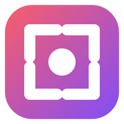
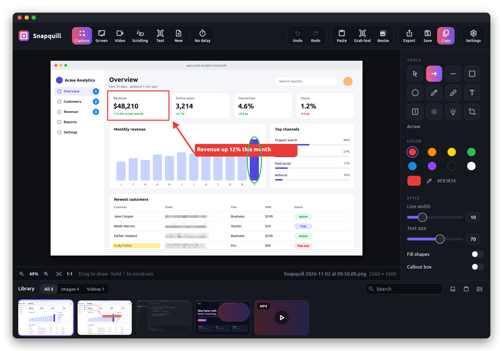
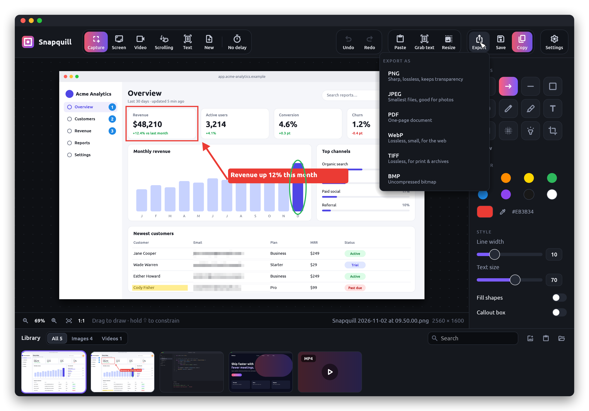
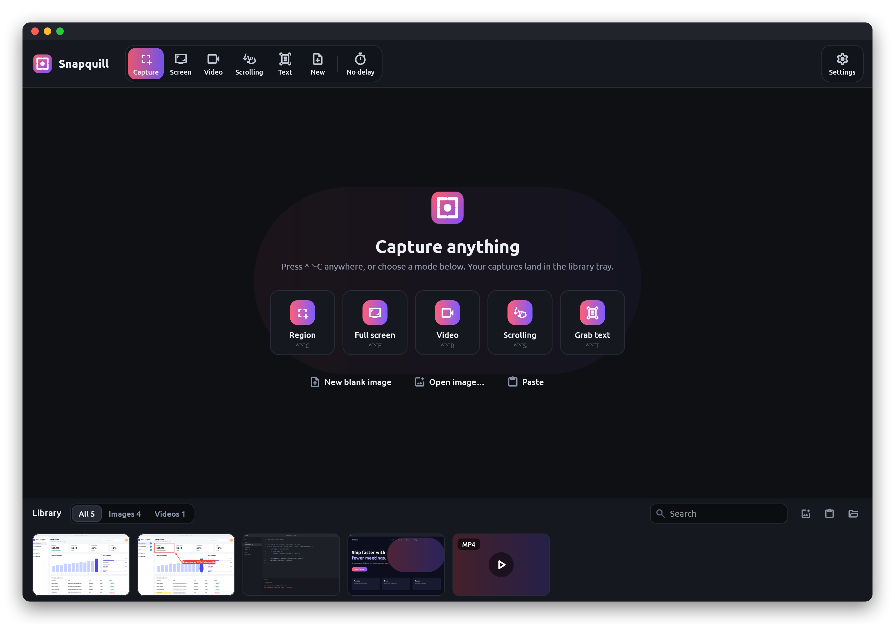
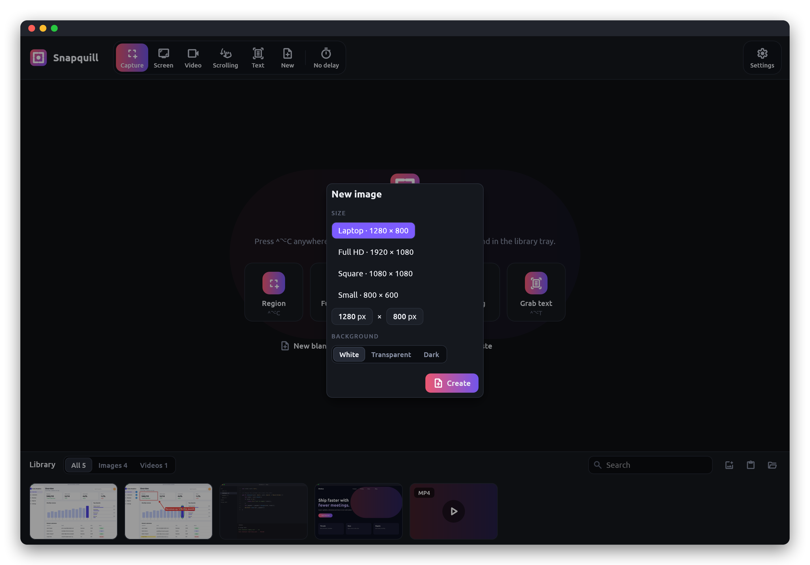

<p align="center">
  
</p>

<h1 align="center">Snapquill</h1>

<p align="center">
  <b>Capture anything on your screen, mark it up, and share it — in seconds.</b><br>
  A fast, native screenshot, screen-recording and annotation tool written in Rust.
</p>

<p align="center">
  
  
  
  
</p>

<p align="center">
  
</p>

---

## Contents

- [Features](#features)
- [Install](#install)
- [Quick start](#quick-start)
- [Examples](#examples)
- [Keyboard shortcuts](#keyboard-shortcuts)
- [How it works](#how-it-works)
- [Development](#development)
- [Roadmap](#roadmap)
- [Credits](#credits)
- [License](#license)

## Features

### Capture

| | |
|---|---|
| **Region & window** | Drag a region on a frozen copy of the screen, or click a window to grab it. A live size label, crosshair and pixel magnifier (with the color's hex code) help you land exactly. |
| **Full screen** | One shortcut, the whole display under your cursor. |
| **Scrolling capture** | Snapquill scrolls the page for you and stitches the frames into one tall image — sticky headers and footers included. |
| **Video** | Record any region to **MP4** (H.264) or **GIF**, with pause/resume and an optional cursor highlight. The control bar stays out of the recording. |
| **Grab text (OCR)** | Select a region and get its text on the clipboard, using macOS's built-in Vision engine. |
| **Delay timer** | 3, 5 or 10 seconds to open a menu or hover state first. |

<p align="center">
  
</p>

### Annotate

Twelve tools in the right-hand panel, each with a one-key shortcut:

| Tool | Key | | Tool | Key |
|---|---|---|---|---|
| Select & move | `V` | | Highlighter | `H` |
| Arrow | `A` | | Text & callouts | `T` |
| Line | `L` | | Step numbers | `N` |
| Rectangle | `R` | | Blur (pixelate) | `B` |
| Ellipse | `E` | | Spotlight | `S` |
| Pen | `P` | | Crop | `C` |

- **Every mark stays editable** — select it to move, recolor, resize or delete. A freshly drawn mark stays selected, so you can tweak its color right away.
- **Eyedropper** (`I`) picks any color straight from the image.
- **Paste images onto the canvas** (`⌘V`) as movable, resizable layers.
- Undo/redo, resize, zoom, `⇧` to snap lines to 45° and keep shapes square.

### Export & share

`⌘C` copies the finished image. **Export** saves it as **PNG, JPEG, PDF, WebP, TIFF or BMP** — formats without transparency are flattened onto white, and PDF export produces a single page sized to the image.

<p align="center">
  
</p>

### Library

Every capture is saved automatically and appears in the **library tray** along the bottom of the window. Filter by images or videos, search, open, reveal in Finder, or delete with the button that appears on hover. Images remain fully re-editable later — the original pixels and your annotations are kept side by side.

<p align="center">
  
</p>

### Start from a blank canvas

**New** (`⌘N`) creates an empty canvas — pick a preset or a custom size and a white, transparent or dark background — then paste screenshots onto it, arrange, crop and export. Handy for before/after comparisons and quick collages.

<p align="center">
  
</p>

### Make it yours

Settings are grouped into **General**, **Video** and **Shortcuts**. Every global shortcut can be re-recorded with a click, and reset individually or all at once.

<p align="center">
  
</p>

Snapquill also lives in the **menu bar**, so captures are one click (or one shortcut) away even when the window is closed.

## Install

### Requirements

- macOS 12.3 or later (Apple Silicon or Intel)
- [Rust](https://rustup.rs) 1.88 or later
- Xcode Command Line Tools (`xcode-select --install`)

No other system libraries are needed — the H.264 encoder is compiled from source.

### Build the app

```sh
git clone https://github.com/<you>/snapquill.git
cd snapquill
./scripts/bundle-macos.sh          # builds target/release/Snapquill.app
open target/release/Snapquill.app
```

To run straight from source instead:

```sh
cargo run --release
```

### Permissions

macOS asks once for each of these:

| Permission | Needed for | Where to grant it |
|---|---|---|
| **Screen Recording** | All captures and video | System Settings › Privacy & Security › Screen Recording |
| **Accessibility** | Scrolling capture only (it sends scroll events) | System Settings › Privacy & Security › Accessibility |

If Screen Recording is missing, macOS only shows apps the empty desktop — Snapquill detects this and shows a banner with **Open Settings** and **Restart** buttons instead of saving a blank capture. Run the `.app` bundle (not the bare binary) so the permission belongs to Snapquill rather than your terminal.

## Quick start

1. Launch Snapquill — its icon appears in the menu bar.
2. Press **`⌃⌥C`** anywhere.
3. Drag over what you want, or click a window, or press **Enter** for the full screen.
4. The capture opens in the editor (and is already on your clipboard).
5. Mark it up, then **`⌘C`** to copy or **Export** to save in another format.

## Examples

**Annotate a bug report**
`⌃⌥C` → click the broken window → `A` and drag an arrow to the problem → `T` and type what's wrong → `B` and drag over any personal data → `⌘C` and paste into your issue tracker.

**Walk someone through a UI**
Capture the screen → press `N` and click each control in order to drop numbered steps **1, 2, 3** → export as **PDF** for a one-page guide.

**Record a quick demo GIF**
Settings › Video › **GIF** → `⌃⌥R` → select the area → do the thing → `⌃⌥R` again to stop. The GIF lands in the library tray.

**Copy text out of an image or video call**
`⌃⌥T` → select the text → it's on your clipboard, and shown in a window you can edit before copying again.

**Capture a whole web page**
`⌃⌥S` → select the browser's content area → Snapquill scrolls to the end and stitches one tall image.

**Build a before/after comparison**
`⌘N` → *Full HD, white* → paste the first screenshot, drag it left → paste the second, drag it right → add labels with `T` → export.

## Keyboard shortcuts

### Global (work in any app — all customizable)

| Shortcut | Action |
|---|---|
| `⌃⌥C` | Capture a region or window |
| `⌃⌥F` | Capture the full screen |
| `⌃⌥R` | Start / stop a video recording |
| `⌃⌥S` | Scrolling capture |
| `⌃⌥T` | Grab text (OCR) |

### In the app

| Shortcut | Action |
|---|---|
| `⌘N` / `⌘O` | New blank image / open an image file |
| `⌘V` | Paste an image onto the canvas (or as a new image) |
| `⌘C` / `⌘S` | Copy the annotated image / save to the library |
| `⌘Z` / `⌘⇧Z` | Undo / redo |
| `⌫` | Delete the selected mark |
| `I` | Eyedropper |
| `0` | Zoom to fit |
| `Esc` | Deselect, cancel a drawing or the eyedropper |

## How it works

Snapquill is a single native binary built on [egui](https://github.com/emilk/egui) (GPU-rendered immediate-mode UI) with a small platform layer for macOS.

| Area | Implementation |
|---|---|
| UI & design system | `eframe`/`egui` with a custom theme (`src/theme.rs`) |
| Screen & window capture | [`xcap`](https://crates.io/crates/xcap) |
| Annotation export | [`tiny-skia`](https://crates.io/crates/tiny-skia) + [`ab_glyph`](https://crates.io/crates/ab_glyph) — exported text matches the editor exactly |
| Video | OpenH264 (MP4) and the [`gif`](https://crates.io/crates/gif) crate, encoded on a background thread |
| OCR | Apple Vision via [`objc2-vision`](https://crates.io/crates/objc2-vision) |
| Global shortcuts & menu bar | [`global-hotkey`](https://crates.io/crates/global-hotkey), [`tray-icon`](https://crates.io/crates/tray-icon) |

### Project layout

```text
src/
├── main.rs            entry point, window setup
├── app.rs             app shell: workspace, library tray, capture flows, menus, settings
├── theme.rs           colors, fonts, icons and shared widgets
├── overlay.rs         full-screen region / window selection
├── capture.rs         screenshots and window detection
├── editor/
│   ├── mod.rs         editor UI and tools
│   ├── model.rs       annotation data model (serializable)
│   └── render.rs      flattening annotations into the final image
├── recorder.rs        video capture and MP4 / GIF encoding
├── scroll.rs          scrolling capture and frame stitching
├── ocr.rs             text recognition
├── shortcuts.rs       customizable global shortcuts
├── library.rs         capture library on disk
└── platform.rs        macOS integration (window levels, permissions, clipboard)
```

## Development

```sh
cargo test --release          # unit tests: rendering, export formats, OCR, stitching, shortcuts…
cargo clippy --release
```

The screenshots in this README are rendered **off-screen** from the real UI with made-up demo content, using [`egui_kittest`](https://crates.io/crates/egui_kittest). To regenerate them after a UI change:

```sh
cargo test --release readme_screenshots -- --ignored
```

They are written to `docs/images/`.

## Roadmap

- [ ] Windows and Linux builds (the code is cross-platform except OCR and a few macOS integrations)
- [ ] Audio in recordings and video trimming
- [ ] Capturing across several displays at once
- [ ] Load Cisco's prebuilt OpenH264 at runtime (H.264 patent licensing)
- [ ] Share links / cloud upload

## Credits

- Interface font: [Ubuntu](https://fonts.google.com/specimen/Ubuntu) — Ubuntu Font Licence 1.0 (`assets/fonts/UFL.txt`)
- Icons: [Material Symbols](https://fonts.google.com/icons) by Google — Apache License 2.0 (`assets/fonts/MaterialSymbols-LICENSE.txt`)
- Keyboard symbols: [Noto Sans Symbols](https://fonts.google.com/noto) — SIL Open Font License 1.1 (`assets/fonts/NotoSans-OFL.txt`)

The bundled icon and symbol fonts are subsets containing only the glyphs Snapquill uses.

## License

Snapquill is released under the [MIT License](LICENSE). Bundled fonts keep their own licenses, listed above.
