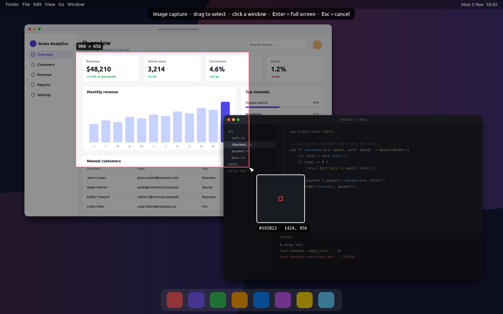
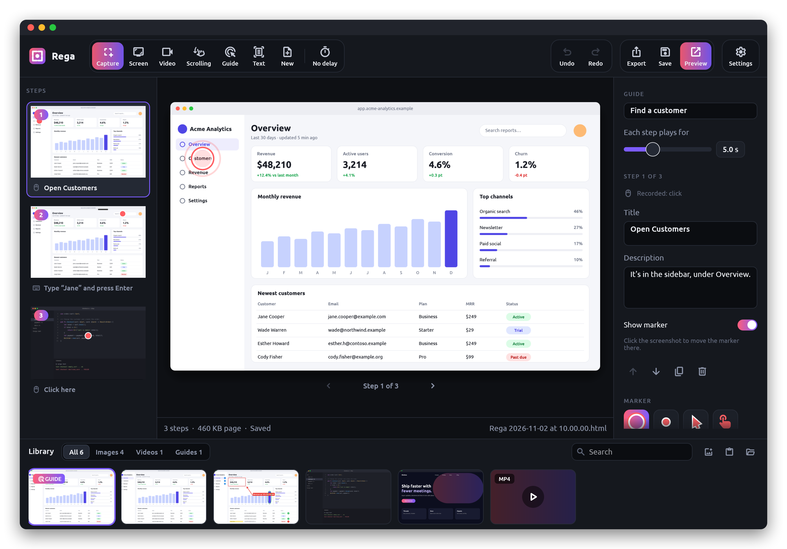
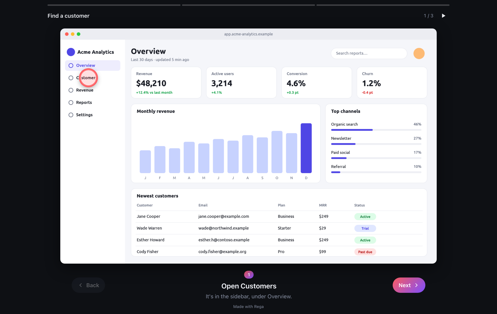
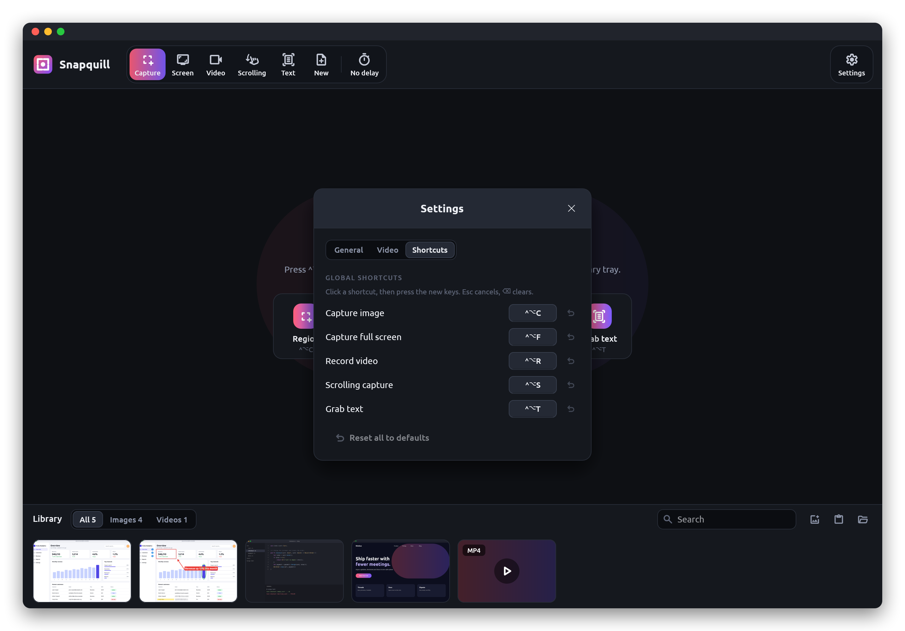
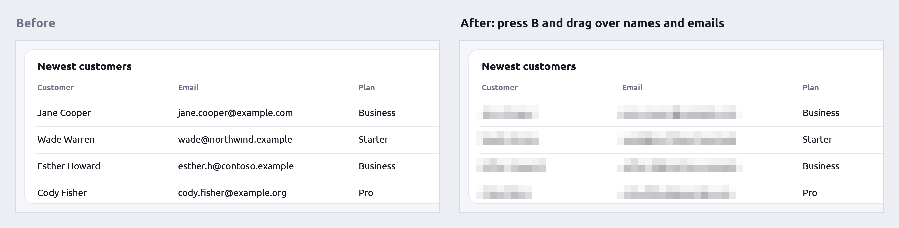
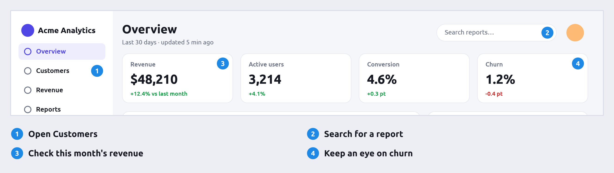
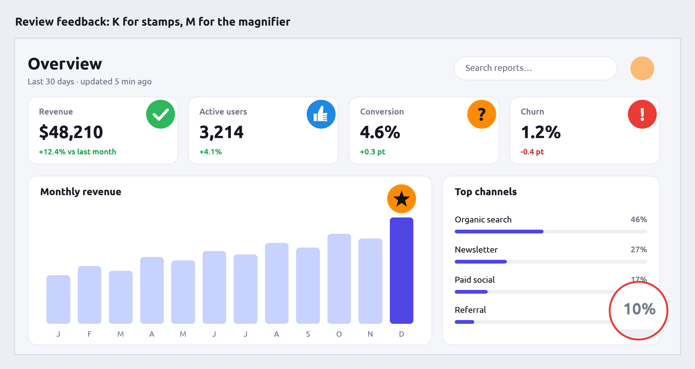

<p align="center">
  
</p>

<h1 align="center">Rega</h1>

<p align="center">
  <b>Capture anything on your screen, mark it up, and share it — in seconds.</b><br>
  A fast, native screenshot, screen-recording, step-by-step guide and annotation tool written in Rust.
</p>

<p align="center">
  
  
  
  
</p>

<p align="center">
  
</p>

---

## Contents

- [Features](#features)
- [Install](#install)
- [Quick start](#quick-start)
- [Examples](#examples)
- [Keyboard shortcuts](#keyboard-shortcuts)
- [How it works](#how-it-works)
- [Development](#development)
- [Roadmap](#roadmap)
- [Credits](#credits)
- [License](#license)

## Features

### Capture

| | |
|---|---|
| **Region & window** | Drag a region on a frozen copy of the screen, or click a window to grab it. A live size label, crosshair and pixel magnifier (with the color's hex code) help you land exactly. |
| **Full screen** | One shortcut, the whole display under your cursor. |
| **Scrolling capture** | Rega scrolls the page for you and stitches the frames into one tall image — sticky headers and footers included. |
| **Guide** | Do a task once and get a step-by-step how-to: every click becomes a step with a screenshot and a marker, shared as one small HTML page. See [Guides](#guides). |
| **Video** | Record any region to **MP4** (H.264) or **GIF**, with pause/resume and an optional cursor highlight. The control bar stays out of the recording. In the built-in player, trim a recording or **Save as GIF** (the whole video or just the trimmed part). |
| **Grab text (OCR)** | Select a region and get its text on the clipboard, using the built-in OCR engine of macOS (Vision) or Windows (Windows.Media.Ocr; install a language pack in Settings › Time & language if none is present). |
| **Pick a color** | One shortcut, a loupe on the pointer over any screen: click a pixel and its hex code (`#AE4E4A`) is on your clipboard, without opening Rega. |
| **Delay timer** | 3, 5 or 10 seconds to open a menu or hover state first. |

<p align="center">
  
</p>

#### Capturing across several displays at once

With more than one display connected, the capture overlay comes up on **every display at the same moment**, each showing its own frozen picture. There's nothing to switch: move the pointer to the display you want and capture there.

- **Region & window** — drag a region or click a window on whichever display it's on. Press **Enter** to take the whole display the pointer is on.
- **Full screen** (`⌃⌥F`) — every display is offered; click the one to take. (With a single display it's captured straight away.)
- **Video, scrolling capture, guides, grab text** — start them the same way: pick the region on any display.
- **Pick a color** — the loupe follows the pointer from display to display.
- **Esc** on any display cancels all of them.

A selection stays on one display: to show two displays side by side, capture each and paste both onto a [blank canvas](#start-from-a-blank-canvas).

### Guides

Press **Guide** (`⌃⌥G`), pick the window or region, and do the task as usual. Rega turns it into steps as you go:

- **Clicks** — each click inside the region becomes a step, with a screenshot taken the moment the button goes down (before anything changes) and a marker on what was clicked. A double-click is one step.
- **Typing** — all the typing in one field is one step (“Type “Jane” and press Enter”), its screenshot retaken once you pause so it shows the text.
- **Shortcuts** — `⌘C`, `Esc` or `Enter` on their own become steps; Rega's own shortcuts don't.

Press `⌃⌥G` or **Stop** on the bar and the guide opens in its editor. Drag steps to reorder them, give each a title and description, click the screenshot to move the marker (or hide it), and pick the marker's look. Every change saves itself.

<p align="center">
  
</p>

**Share one file.** A guide is a single HTML page with every screenshot inside: mail it, upload it, or open it in any browser, offline. It plays like stories — a progress bar per step along the top, moving on by itself — with **Back** / **Next**, arrow keys, taps on either side of the picture, and a link to each step (`#3`). It works on phones and follows the viewer's light or dark mode.

<p align="center">
  
</p>

**Small pages.** Screenshots are capped in size (1920 px by default), and a step that only changed part of the screen — typing, a menu opening — is stored as just the changed tiles over the step before. Each picture is kept as JPEG or PNG, whichever is smaller: five steps over four different screens come to about 800 KB.

**Settings › Guide** sets what new guides start with, and what recording picks up:

| | |
|---|---|
| **Marker** | Ring, dot, pointer, hand, spotlight (dims all but the spot) or the step's number; any colour; small, medium or large |
| **Timing** | How long each step plays (2–12 s; long captions stay up longer) |
| **Page** | Play automatically, start over at the end, light / dark / follow the viewer, “Made with Rega” |
| **Quality** | Small (1440 px), Balanced (1920 px), Sharp (2560 px) or Lossless |
| **Recording** | Record typing; put typed text in captions (off: “Type here”, and the text is never kept); record shortcuts and key presses |

Each guide keeps its own look, so changing a default never changes a page already shared; **Page options** in the editor changes one guide, and **Use for new guides** makes it the default. On macOS, typing into password fields is never seen.

### Annotate

Sixteen tools in the right-hand panel, each with a one-key shortcut:

| Tool | Key | | Tool | Key |
|---|---|---|---|---|
| Select & move | `V` | | Highlighter | `H` |
| Arrow | `A` | | Text & callouts | `T` |
| Line | `L` | | Step numbers | `N` |
| Shape: rectangle (`R`) or ellipse (`E`) | `R` `E` | | Blur (pixelate or blur) | `B` |
| Select area | `G` | | Spotlight | `S` |
| Pen | `P` | | Crop | `C` |
| Stamp (24 symbols: ✓ ✗ ! ? 👍 ★ ♥ …) | `K` | | Magnifier | `M` |
| Fill (paint bucket) | `F` | | Eraser | `X` |

- **Every mark stays editable** — select it to move, recolor, resize or delete. A freshly drawn mark stays selected, so you can tweak its color right away. With any drawing tool, a click on an existing mark selects it for moving.
- **The properties panel follows what you're doing**: it shows only what applies to the current tool or the selected mark — rectangle or ellipse, line width and *Fill shape* for shapes, size and callout box for text, the symbol and size for stamps, zoom for the magnifier, tolerance for the fill.
- **Eyedropper** (`I`) picks any color straight from the image.
- **Rotate marks**: drag the round handle above a selected mark (hold `⇧` for 15° steps), or type an angle, turn it 90° or reset it under **Rotation** in the side panel. Shapes, lines, strokes, text, pasted pictures and stamps turn.
- **Paste images onto the canvas** (`⌘V` / `Ctrl+V`) as movable, resizable layers — copied pixels, or image files copied in Finder / Explorer (all of them at once) — or drag image files onto the canvas. Right-click one → **Flatten image** to merge it into the picture so blur, fill and the magnifier work on it too (**Flatten all** merges every mark).
- **Select an area** (`G`): drag over part of the picture, then drag it somewhere else — it lifts off as a picture you can move, resize, turn or delete like any other mark. Hold `⌥` / `Alt` to drag a copy instead. `⌘X` / `Ctrl+X` cuts the area, `⌘C` copies it and `⌫` deletes it. `⌘A` / `Ctrl+A` selects the whole picture. Where it was is filled with the color around it when that is one color (a word lifted off a page leaves page), otherwise left transparent (or always, with **Transparent** in the side panel). Marks lying wholly inside the area go with it, and a blur over it stays blurred.
- **Change the canvas size**: drag any of the eight handles on the image's edge — outward to add space around the picture, inward to trim it. New space takes the canvas color, or is transparent on a screenshot. A mark drawn, placed or moved past the edge grows the canvas to hold it.
- **Rotate the whole image** a quarter turn left or right (**Rotate** in the top bar); every mark turns with it.
- Undo/redo, resize, zoom, `⇧` to snap lines to 45° and keep shapes square.

### Export & share

`⌘C` copies the finished image. **Export** saves it as **PNG, JPEG, PDF, WebP, TIFF or BMP** — formats without transparency are flattened onto white, and PDF export produces a single page sized to the image.

<p align="center">
  
</p>

### Library

Every capture is saved automatically and appears in the **library tray** along the bottom of the window. Filter by images, videos or guides, search, open, reveal in Finder / Explorer, or delete with the button that appears on hover. Images remain fully re-editable later — the original pixels and your annotations are kept side by side.

<p align="center">
  
</p>

### Start from a blank canvas

**New** (`⌘N`) creates an empty canvas — pick a preset or a custom size (with an image on the clipboard, the custom size starts as that image's) and a white, transparent or dark background — then paste or drag screenshots onto it, arrange, crop and export. Handy for before/after comparisons and quick collages.

To open image files as new captures, drag them onto the library, paste them (`⌘V` on the welcome screen) or use **Open image…** (`⌘O`).

<p align="center">
  
</p>

### Make it yours

Settings are grouped into **General**, **Video** and **Shortcuts**. Every global shortcut can be re-recorded with a click, and reset individually or all at once.

<p align="center">
  
</p>

Rega also lives in the **menu bar** (macOS) or **system tray** (Windows), so captures are one click (or one shortcut) away even when the window is closed.

## Install

Download the installer for macOS or Windows from **[rega-capture.vercel.app](https://rega-capture.vercel.app/#download)**, or build Rega from source as below.

### Requirements

- macOS 12.3 or later (Apple Silicon or Intel), or Windows 10 / 11 (64-bit; on N editions, MP4 video needs Microsoft's free Media Feature Pack)
- [Rust](https://rustup.rs) 1.88 or later
- macOS: Xcode Command Line Tools (`xcode-select --install`)
- Windows: Visual Studio Build Tools (C++ workload), and LLVM for the [`minimp4-sys`](https://crates.io/crates/minimp4-sys) bindings: `winget install LLVM.LLVM`, or the "C++ Clang tools for Windows" component
- For the universal macOS build: `rustup target add aarch64-apple-darwin x86_64-apple-darwin`

MP4 video uses the H.264 codec built into the operating system (VideoToolbox on macOS, Media Foundation on Windows), so Rega ships no H.264 encoder of its own.

### Build the app

```sh
git clone https://github.com/shairai/Rega.git
cd Rega
./scripts/bundle-macos.sh          # builds target/release/Rega.app
open target/release/Rega.app
```

On Windows, `cargo build --release` produces `target\release\rega.exe`; the installer is built in CI from `scripts/installer.nsi`.

To run straight from source instead:

```sh
cargo run --release
```

### Permissions

*Windows needs none of this: capture and shortcuts work without any permission prompt.*

macOS asks once for each of these:

| Permission | Needed for | Where to grant it |
|---|---|---|
| **Screen Recording** | All captures and video | System Settings › Privacy & Security › Screen Recording |
| **Accessibility** | Scrolling capture (it sends scroll events) and guides (they see your clicks and typing) | System Settings › Privacy & Security › Accessibility |

On first launch Rega shows a **Set up** popup listing each permission with its live status and an **Enable** button that opens the right System Settings pane (and adds Rega to the list). You can skip it; while anything is missing a banner stays at the top with **Review permissions** to reopen the popup. macOS applies Screen Recording only after a restart, so the popup offers **Restart Rega** once you've pressed Enable. Without Screen Recording, Rega won't save a blank capture: it opens the popup instead. Run the `.app` bundle (not the bare binary) so the permissions belong to Rega rather than your terminal.

## Quick start

1. Launch Rega — its icon appears in the menu bar (macOS) or system tray (Windows).
2. Press **`⌃⌥C`** (`Ctrl+Alt+C` on Windows) anywhere.
3. Drag over what you want, or click a window, or press **Enter** for the full screen.
4. The capture opens in the editor (and is already on your clipboard).
5. Mark it up, then **`⌘C`** to copy or **Export** to save in another format.

## Examples

**Annotate a bug report**
`⌃⌥C` → click the broken window → `A` and drag an arrow to the problem → `T` and type what's wrong → `B` and drag over any personal data → `⌘C` and paste into your issue tracker.

**Hide sensitive info**
Open any capture → press `B` and drag over emails, names, tokens or faces → they're hidden in the image and in every export. Choose **Pixelate** or a smooth **Blur**, each with adjustable strength. To black out text completely, draw a rectangle with **Fill shape** instead. The blur stays a mark you can select, move or resize until you export, so you can fix a missed spot later.

<p align="center">
  
</p>

**Walk someone through a UI**
Capture the screen → press `N` and click each control in order to drop numbered steps **1, 2, 3** (the count goes up automatically) → add a `T` label beside each → export as **PDF** for a one-page guide. Combine with `B` to blur anything private first. Flow carries on in another screenshot? Set **Start at** in the Step tool's panel (numbers already placed move with it), or press **Continue at 4** to pick up after the last number you placed on another image.

<p align="center">
  
</p>

**Give review feedback**
Open a capture → press `K` and click to drop stamps (✓, 👍, ?, ! and 20 more) on what's good, unclear or broken → press `M` and drag a magnifier over small text so nobody has to squint → `⌘C` and paste into the review thread. Drag any corner to resize a stamp or loupe.

<p align="center">
  
</p>

**Record a quick demo GIF**
Settings › Video › **GIF** → `⌃⌥R` → select the area → do the thing → `⌃⌥R` again to stop. The GIF lands in the library tray.

**Copy text out of an image or video call**
`⌃⌥T` → select the text → it's on your clipboard, and shown in a window you can edit before copying again.

**Grab a color from anything on screen**
`⌃⌥P` → click the pixel → its hex code is on your clipboard.

**Capture a whole web page**
`⌃⌥S` → select the browser's content area → Rega scrolls to the end and stitches one tall image.

**Write a how-to without writing**
`⌃⌥G` → select the app's window → do the task → `⌃⌥G` again. Rega opens the steps: name the guide, adjust captions, then **Preview** or **Export** the HTML page and send it.

**Build a before/after comparison**
`⌘N` → *Full HD, white* → paste the first screenshot, drag it left → paste the second, drag it right → add labels with `T` → export. To blur or fill inside a pasted shot, right-click it → **Flatten image** first.

## Keyboard shortcuts

> **Windows:** read `⌘` as `Ctrl`, `⌥` as `Alt`, `⇧` as `Shift`. `⌃` is `Ctrl`.

### Global (work in any app — all customizable)

| Shortcut | Action |
|---|---|
| `⌃⌥C` | Capture a region or window |
| `⌃⌥F` | Capture the full screen |
| `⌃⌥R` | Start / stop a video recording |
| `⌃⌥S` | Scrolling capture |
| `⌃⌥G` | Start / stop recording a guide |
| `⌃⌥T` | Grab text (OCR) |
| `⌃⌥P` | Pick a color: its hex code goes on the clipboard |

### In the app

| Shortcut | Action |
|---|---|
| `⌘N` / `⌘O` | New blank image / open an image file |
| `⌘V` | Paste an image onto the canvas (or as a new image) |
| `⌘C` / `⌘S` | Copy the annotated image / save to the library |
| `⌘Z` / `⌘⇧Z` | Undo / redo |
| `⌫` | Delete the selected mark |
| `I` | Eyedropper |
| `0` | Zoom to fit |
| `Esc` | Deselect, cancel a drawing or the eyedropper |
| `⌘W` | Close the open capture (again: close the window; Rega stays in the menu bar) |
| `⌘D` | Delete the open capture, or the selected library items |
| `⌘Q` | Quit Rega |
| `⌘`-click / `⇧`-click | Select several library items, or a range, to delete them together |

### In a guide

| Shortcut | Action |
|---|---|
| `←` `→` / `↑` `↓` | Previous / next step |
| `⌥↑` / `⌥↓` | Move the step up / down |
| `⌫` | Delete the step |
| `⌘Z` / `⌘⇧Z` | Undo / redo |
| `⌘S` | Save now (changes also save by themselves) |

On the shared page: `←` `→` move between steps, `Space` pauses, `Home` / `End` jump to the first / last step.

## How it works

Rega is a single native binary built on [egui](https://github.com/emilk/egui) (GPU-rendered immediate-mode UI) with a small platform layer for macOS and Windows.

| Area | Implementation |
|---|---|
| UI & design system | `eframe`/`egui` with a custom theme (`src/theme.rs`) |
| Screen & window capture | [`xcap`](https://crates.io/crates/xcap) |
| Annotation export | [`tiny-skia`](https://crates.io/crates/tiny-skia) + [`ab_glyph`](https://crates.io/crates/ab_glyph) — exported text matches the editor exactly |
| Video | H.264 through the system codec (VideoToolbox on macOS, Media Foundation on Windows), written to MP4 with [minimp4](https://github.com/lieff/minimp4) (through [`minimp4-sys`](https://crates.io/crates/minimp4-sys)); GIF with the [`gif`](https://crates.io/crates/gif) crate; frames scaled with SIMD by [`pic-scale`](https://crates.io/crates/pic-scale); encoded on a background thread |
| OCR | Apple Vision via [`objc2-vision`](https://crates.io/crates/objc2-vision) |
| Global shortcuts & menu bar | [`global-hotkey`](https://crates.io/crates/global-hotkey), [`tray-icon`](https://crates.io/crates/tray-icon) |

### Project layout

```text
src/
├── main.rs            entry point, window setup
├── app.rs             app shell: workspace, library tray, capture flows, menus, settings
├── theme.rs           colors, fonts, icons and shared widgets
├── overlay.rs         full-screen region / window selection
├── border.rs          the moving gradient around a selection or recording
├── capture.rs         screenshots and window detection
├── editor/
│   ├── mod.rs         editor UI and tools
│   ├── model.rs       annotation data model (serializable)
│   └── render.rs      flattening annotations into the final image
├── recorder.rs        video capture and MP4 / GIF encoding
├── h264/              H.264 through the system codec (VideoToolbox / Media Foundation)
├── resize.rs          frame scaling for recordings and GIFs
├── player.rs          video player, trimming and Save as GIF
├── scroll.rs          scrolling capture and frame stitching
├── guide/
│   ├── mod.rs         guide model and its editable sidecar
│   ├── input.rs       seeing clicks and keys (event tap / low-level hooks)
│   ├── recorder.rs    turning clicks and typing into steps with screenshots
│   ├── export.rs      the shared HTML page, with changed-tile patches
│   ├── page.html      the page's template and player
│   ├── style.rs       marker, timing, page and quality options (Settings › Guide)
│   └── editor.rs      guide editor UI
├── ocr.rs             text recognition
├── shortcuts.rs       customizable global shortcuts
├── library.rs         capture library on disk
├── update.rs          daily check of the website's latest.json for a new version
└── platform.rs        macOS / Windows integration (window levels, permissions, clipboard)
```

## Development

```sh
cargo test --release          # unit tests: rendering, export formats, OCR, stitching, shortcuts…
cargo clippy --release
```

Video goes through the OS codec, so the H.264 tests exercise whichever platform they run on. The Windows backend can be cross-compiled from a Mac (`scripts/package-windows-cross.sh`) but only runs on Windows: before a release, run `cargo test --release -- h264 recorder player` on a Windows 10/11 PC, and record a guide there (clicks, typing with AltGr characters, a shortcut): its mouse and keyboard hooks only run on Windows.

The screenshots in this README are rendered **off-screen** from the real UI with made-up demo content, using [`egui_kittest`](https://crates.io/crates/egui_kittest). To regenerate them after a UI change:

```sh
cargo test --release readme_screenshots -- --ignored
```

They are written to `docs/images/`. The shared guide page is a web page, so its picture comes from a browser: the run above also writes `target/guide-readme.html`; then

```sh
"/Applications/Google Chrome.app/Contents/MacOS/Google Chrome" --headless=new --hide-scrollbars \
  --force-prefers-reduced-motion --force-device-scale-factor=2 --window-size=1360,860 \
  --screenshot="$PWD/docs/images/guide-page.png" "file://$PWD/target/guide-readme.html#1"
```

To look at a guide page with other markers or themes, `GUIDE_MARKER=spotlight GUIDE_THEME=light cargo test sample_page -- --ignored` writes `target/guide-sample.html`.

## Website and releases

The website lives in [`site/`](site/): static pages, the installers and
`latest.json`, which Rega reads once a day to tell users a new version is out
(Settings › General › Updates turns that off). Release notes are written in
[`CHANGELOG.md`](CHANGELOG.md). To publish a version: bump `Cargo.toml`, write
its notes, build both installers, then run `./scripts/publish-site.sh`, which
regenerates the site from the changelog and deploys it to Vercel. See
[`site/README.md`](site/README.md) for details.

## Roadmap

- [x] Windows build
- [x] Step-by-step guides, shared as one HTML page
- [ ] Audio in recordings
- [x] [Capturing across several displays at once](#capturing-across-several-displays-at-once)
- [x] H.264 through the operating system's codec instead of a bundled encoder (patent licensing)
- [ ] Share links / cloud upload

## Credits

- Interface font: [Ubuntu](https://fonts.google.com/specimen/Ubuntu) — Ubuntu Font Licence 1.0 (`assets/fonts/UFL.txt`)
- Icons: [Material Symbols](https://fonts.google.com/icons) by Google — Apache License 2.0 (`assets/fonts/MaterialSymbols-LICENSE.txt`)
- Keyboard symbols: [Noto Sans Symbols](https://fonts.google.com/noto) — SIL Open Font License 1.1 (`assets/fonts/NotoSans-OFL.txt`)
- Hebrew text: [Noto Sans Hebrew](https://fonts.google.com/noto/specimen/Noto+Sans+Hebrew) — SIL Open Font License 1.1 (`assets/fonts/NotoSansHebrew-OFL.txt`)

The bundled icon and symbol fonts are subsets containing only the glyphs Rega uses.

## License

Rega is released under the [MIT License](LICENSE). Bundled fonts keep their own licenses, listed above.
